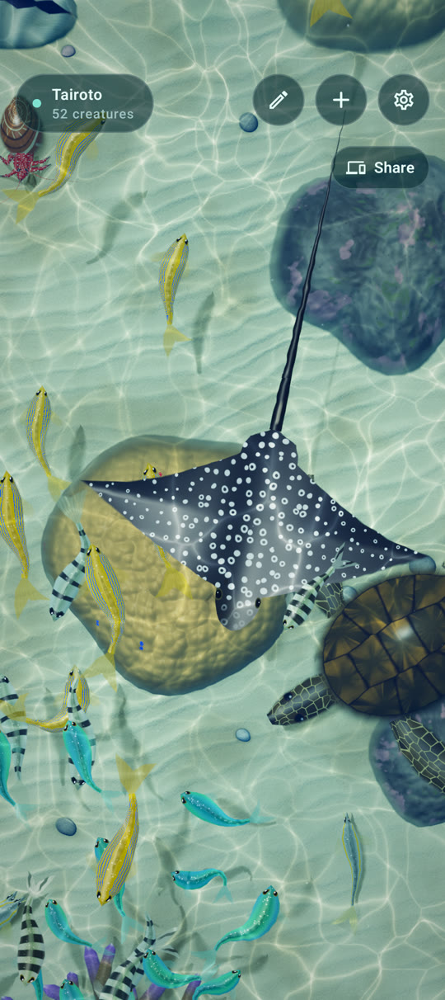
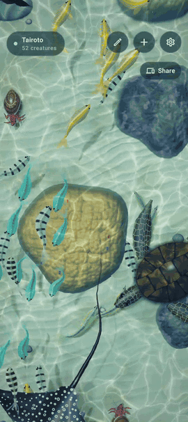
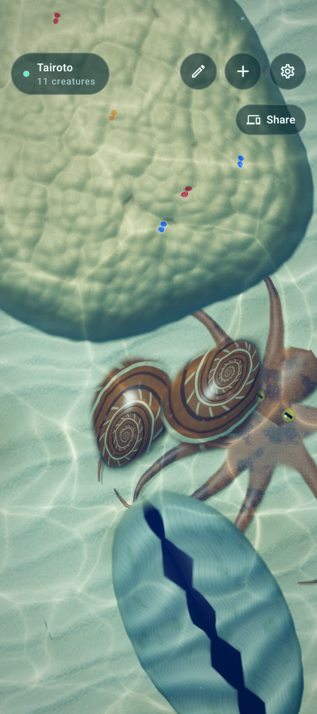
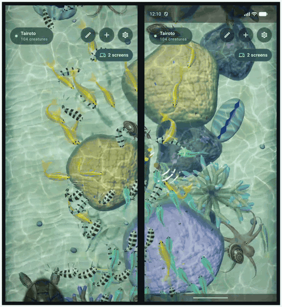
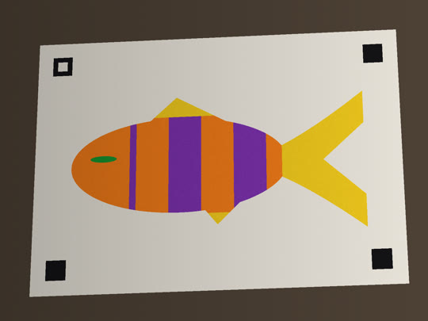
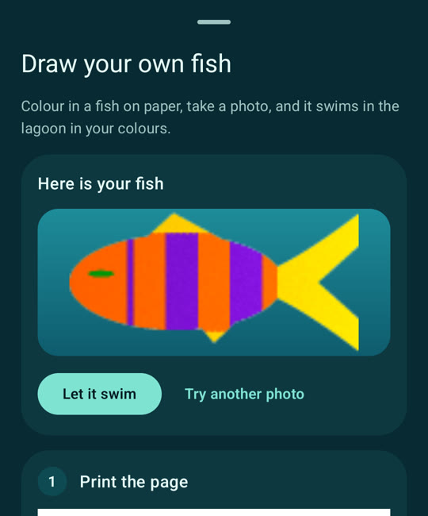
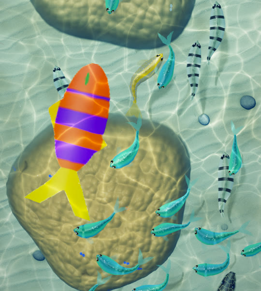
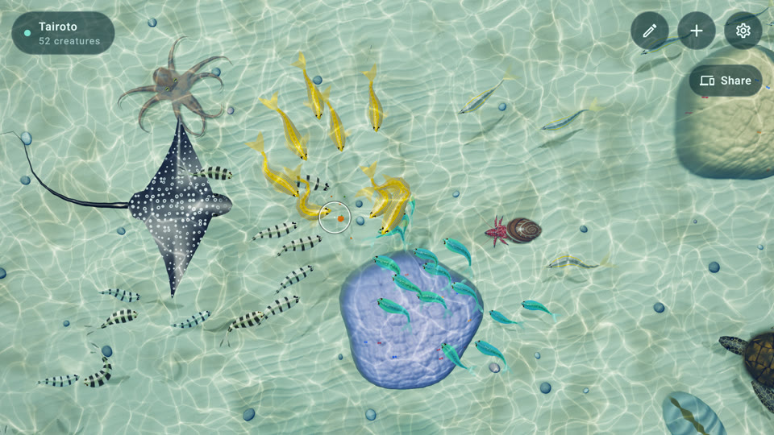
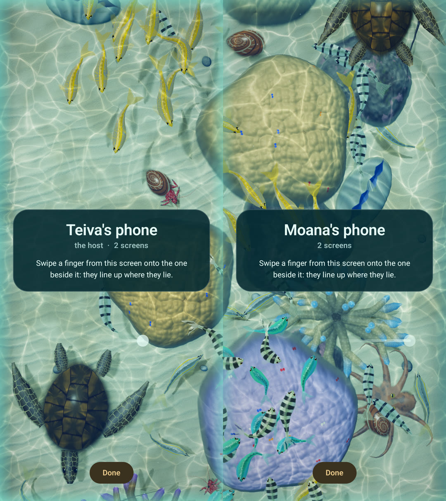
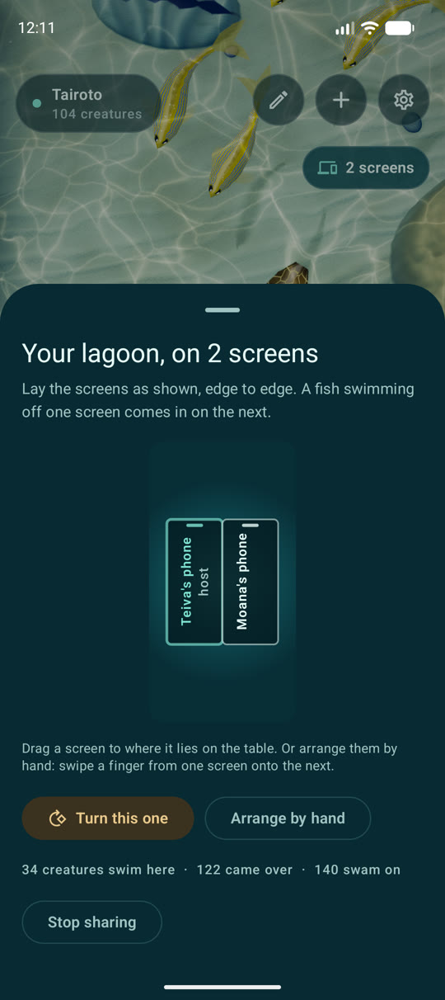

# Tairoto

[](https://github.com/jpcottin/Tairoto/actions/workflows/ci.yml)


[](LICENSE)

*Tairoto* is Tahitian for lagoon. This is one, for Android, seen from above:
reef fish, a turtle, an eagle ray, an octopus and hermit crabs over white coral
sand, under moving caustic light, every creature called by its Tahitian name.
Lay several phones side by side and it becomes **one lagoon across all of
them**: a fish swimming off one screen comes in on the next.

<p align="center">
  
  &nbsp;
  
  &nbsp;
  
</p>

<p align="center">
  
  <br>
  <em>Two phones, one lagoon: food dropped on the seam draws fish from both sides across it.</em>
</p>

Everything is drawn at run time, with no textures: a C++ simulation (schooling,
beat-and-glide swimming, an octopus on soft arms, a ray that buries itself) and
a Vulkan renderer (procedural sand, caustics, refraction, soft shadows,
creatures painted in shaders), under a Jetpack Compose app.

> Work in progress: milestones 1 to 7 of 10. Solo lagoon, food and feeding,
> bottom dwellers, arranging the lagoon, one lagoon across devices (relay,
> Wi-Fi, Bluetooth), laying the screens out on the table, and the lagoon's
> sound, live wallpaper and screensaver. Next: scanning drawn fish with the
> camera, TV and Wear.

Tahitian names are checked against a reference before they are used, and the
source is noted next to each species in `Species.kt`.

## What is in it

- **The creatures of the lagoon**, each by its Tahitian name (sources in `Species.kt`):
  five schools of small fish — ʻatoti (green chromis), manini (convict surgeonfish),
  taape (bluestripe snapper), ʻouma (yellowstripe goatfish, with its barbels) and
  mamo (scissortail sergeant) — the honu (green sea turtle), the fai manu
  (ocellated eagle ray) that flaps, glides and buries itself in the sand, the feʻe
  (day octopus) that walks on soft arms, camouflages, inks and jets away, and the
  uʻa (hermit crab) that steps on planted feet and hides in its shell.
- **A lagoon floor to arrange**, each piece by its Tahitian name (sources in
  `Decor.kt`): toʻa (a Porites coral head, knobbly, with Christmas tree worms),
  toʻapū (branching Acropora coral), pahua (the giant clam, its mantle blue,
  green or gold) and ʻōfaʻi (a stone crusted with coralline algae). They are
  part of the lagoon, not scenery: fish swim over them or around them,
  crabs and the octopus walk round them, food settles on top, the turtle may
  rest on a coral head, the octopus makes its den against one, frightened
  chromis dive in among the branches of a toʻapū, and the clam snaps shut
  (with a puff) when a shadow or a knock comes near, then opens again slowly.
- **Arranging**: the pencil button turns the lagoon into an edit mode: drag a
  decoration to move it, twist with two fingers (or tap ↻) to turn it, take it
  away, place new ones from the picker's Decorations tab, or take up the net
  and tap a creature to scoop it out. Every change can be undone and redone
  (a whole drag is one change; undoing a netted creature puts it back where
  it was caught).
- **Draw your own fish**: print a fish outline from the picker (Creatures tab,
  "Draw your own fish"), colour it in, and photograph it. The app finds the
  page by its four corner squares, straightens it, and the fish swims in the
  lagoon wearing the drawing (see [Draw your own fish](#draw-your-own-fish)).
- **The lagoon is kept**: saved a moment after every change and when the app
  goes to the background, every creature where it is at that moment, and
  restored at the next launch (a versioned file that tolerates damage and
  species it does not know).
- **One lagoon across several devices**: lay phones, foldables and tablets side
  by side and share the lagoon (the Share button). Each screen is a life-size
  window onto one tank on the table; a fish swimming off one screen comes in on
  the next, and food dropped on one draws fish from the others. On a local
  network the host device runs the relay itself and announces it (NSD); the
  others find it in the share sheet. Emulators, which cannot see each other, go
  through a relay on the computer. More in *Sharing* below.
- **Adaptive layout**: on a tablet, an unfolded foldable or a desktop window the
  species picker and the settings open as a pane beside the running lagoon; on a
  phone or a cover screen the picker is a sheet over it. Folding and unfolding
  move them between the two, and the lagoon widens for a bigger window
  (Navigation 3 scenes: supporting pane, bottom sheet).

- **Sound, made as it plays** (`engine/src/main/cpp/audio`): no recordings.
  Lapping water over the crackle of a reef (snapping shrimp), and a sound for
  what happens: a knock on the glass, flakes pattering, a pellet's plop, fish
  snapping at food, the giant clam clapping shut, sand puffing up, the octopus
  jetting away, the turtle breathing at the surface. Each is placed where it
  happens on the glass and duller the deeper it is; in a shared lagoon a
  screen plays what it shows. AAudio, stopped whenever the lagoon is unseen.
  `scripts/host-tests.sh` writes twenty scripted seconds to
  `build/host-tests/lagoon.wav`.
- **Live wallpaper and screensaver**: the lagoon behind the home screens
  (swiping between them pans across it, a tap ripples the water) and as the
  screensaver while charging; drawn at the Low tier, silent, paused when
  unseen. Settings, *Beyond the app*.
- **Food and feeding**: drag to sprinkle flakes, hold for a pellet; a scent that grows
  with the food and the feeders draws fish from further away; messy bites, crumbs,
  decomposition, every milligram accounted for; a current grid stirred by tails.
- **C++ simulation** (`engine/src/main/cpp/sim`): schooling with a spatial grid,
  beat-and-glide swimming, a spine that bends into turns, a caudal fin on a
  damped spring; a turtle that cruises, rests on the sand, climbs to breathe
  and flees when tapped. Fixed 120 Hz steps, deterministic for a seed.
- **Vulkan renderer** (`engine/src/main/cpp/render`, `shaders/`): an HDR scene
  pass (procedural sand, pebbles, two-layer caustics, soft depth-scaled
  shadows, marine snow, creatures painted entirely in shaders) and a composite
  pass (surface refraction, sun glints, tap ripples, ACES tone mapping, grade,
  vignette, dither). No textures anywhere.
- **Top-down 2.5D**: millimetres on the table and depth below the surface,
  with a shared projection (`Camera.kt`, `camera.h`, `common.glsl`).
- **Quality tiers** Low / High / Ultra / CI, with an automatic governor fed by
  frame rate and thermal headroom; ADPF performance hints from the render thread.
- **Kotlin core** (`core/world`): geometry, camera, species catalogue, entity
  ownership with epochs, the `Link` abstraction, the session, and `SharedTank`,
  which runs a shared lagoon on each device (handoffs, leases, food, clock).
- **Transport** (`core/net`, `relay`): a small framed-TCP relay and the link to
  it; the same relay runs on a computer for emulators and inside the host
  device on a local network.
- **Compose app**: full-bleed tank, glass HUD, creature picker with drawn
  species portraits, settings (Navigation 3, DataStore).

## Draw your own fish

<p align="center">
  
  &nbsp;
  
  &nbsp;
  
</p>

1. **Print the page**: an A4 page (Letter works too) with a fish outline and a
   black square in each corner, the top-left one hollow. It goes through the
   system's printing, so it can also be saved as a PDF.
2. **Colour it in** with anything bright, keeping the four squares clean.
3. **Take a photo** with the camera app, or choose one. The scanner
   (`PageScanner.kt`, plain Kotlin) finds the squares as dark blobs against
   their surroundings, so uneven light does not matter. The hollow square
   tells it which way up the page is, whichever way the phone was held. It
   straightens the page with a homography, reads the paper's own white as
   white, and cuts the fish out along the printed outline.
4. **Let it swim**: the drawing becomes a 128 × 64 skin, a few kilobytes. It
   is saved with the lagoon, sent to the other screens of a shared lagoon,
   and brought along by a guest. In the engine, drawings sit in a texture
   array, up to 16 in a lagoon. A drawn fish is one ribbon wearing its
   drawing. When it turns to swim the other way, it rolls over to show its
   other side rather than swim upside down.

The page photo above is made up for the tests (`PagePhotos.kt`); the other two
pictures are the app on an emulator scanning it.

## On a TV, with a remote or a keyboard

<p align="center">
  
</p>

Tairoto is in the Android TV launcher. A TV is watched from across the room,
so its lagoon is drawn as if the screen were 240 mm wide: the fish look as big
from the sofa as on a phone in the hand. The water takes the remote's keys,
and a keyboard or a game controller works the same on any device:

| Key | Does |
|---|---|
| Arrows | move a cursor on the water; at the edge they pan the lagoon |
| OK, Enter, A | tap the glass |
| OK held | drop a pellet |
| F, X, Play | sprinkle flakes |
| + / −, channel up / down | zoom |
| Up from the top edge | the buttons; Down from them comes back to the water |

The buttons show a bright ring when they have the focus.

## Build and test

```sh
./gradlew :app:assembleDebug
./gradlew :core:world:test                  # Kotlin core (JVM)
./gradlew :app:testDebugUnitTest            # view model (JVM, fake engine)
./gradlew :engine:nativeHostTest            # C++ simulation and meshes, on the host
./gradlew :app:validateDebugScreenshotTest  # Compose screenshots
./gradlew :engine:connectedDebugAndroidTest :app:connectedDebugAndroidTest  # on a device
scripts/fold-tests.sh                       # on a foldable emulator: folds and unfolds it (espresso-device)
```

Previews for every major form factor (phone, foldable, tablet, desktop) are in
`app/src/main/kotlin/.../ui/preview`; the screenshot tests render the same content.

Deterministic launch for screenshots (debug builds):

```sh
adb shell am start -n com.jpcottin.tairoto/.MainActivity --ez tairoto.ci true --el tairoto.seed 7
# also: --es tairoto.quality low|high|ultra|ci  --ez tairoto.stats true  --ez tairoto.hints false
#       --es tairoto.population "day_octopus:1,hermit_crab:2"  --ef tairoto.zoom 2.5   (a close look)
#       --es tairoto.decor "coral_head:1,giant_clam:2"   (these decorations, in a column down the middle)
#       --ez tairoto.fresh true   (a new lagoon, the saved one left alone; ci, population and decor imply it)
#       --es tairoto.share host|join --es tairoto.relay 10.0.2.2:7171 --es tairoto.session name
#       --ez tairoto.trace true   (log every ownership message of a shared lagoon)
```

### Continuous integration

Every push runs three jobs on GitHub Actions (`.github/workflows/ci.yml`):

- **checks**: the Kotlin unit tests (core, engine, view model), the Compose
  screenshot tests, the native C++ tests on the host, and the build.
- **ui-tests**: the instrumented UI tests on a headless emulator that draws
  with lavapipe, Mesa's software Vulkan, so no GPU is needed and every run
  draws the same pixels (`scripts/ci-emulator.sh` makes the same emulator
  locally, on its own port).
- **two-emulators**: one lagoon on two lavapipe emulators: a finger swiped
  across both lays them side by side (`scripts/arrange-e2e.sh`), and fish
  change hands through the relay and over emulated Bluetooth, never simulated
  twice, no food lost (`scripts/share-e2e.sh`).

The pictures above come from `scripts/readme-media.sh`, recorded on emulators
that draw on the computer's GPU.

## Gestures

Tap the water: a ripple, and the fish nearby dart away (on the next screen too,
when shared). Double tap: zoom. Two fingers: pan and pinch (not when shared:
each screen then shows its own place on the table, life size). Mouse: drag to pan, wheel to zoom. One finger
dragging sprinkles flakes; hold for a pellet.

Arranging (the pencil button): tap a decoration to select it, drag it to move
it, twist two fingers to turn it; drag over open water to pan. With the net:
tap a creature. Back or Done to finish.

## Sharing

Every creature and every piece of food has exactly one owner, the only device
that simulates it. The others show a ghost: animated there like anything else
(so a fish crossing an edge looks the same on both screens) and pulled toward
the owner's states, which come 15 times a second to the screens near it and a
few times a second to the others.

When a creature swims onto another screen its owner stops simulating it and
offers it with the next epoch; the receiver claims it and the host, the
referee, confirms. The receiver starts only on that word, so a creature is
never simulated by two devices at once (for a tick or two it is simulated by
none, and its ghosts drift on). An offer nobody claims runs out after half a
second. A device simulates only while the host answered one of its pings less
than 2 s ago, and the host takes over a silent device's creatures only after
2.5 s, so this holds even when the network splits. Food changes hands the same
way, a bite at food on another screen is decided by the device that owns the
food, and the scent of food spreads to the other screens. Shared time is the
host's, estimated NTP-style.

From the share sheet: *Share nearby*, or join a lagoon found nearby. A host
that shares nearby runs the relay itself and can be reached two ways at once:
on the local network (announced with NSD as `_tairoto._tcp`) and over
Bluetooth LE (Android 12 and up: a BLE advertisement carries the number of an
L2CAP channel, no pairing). A lagoon heard of both ways is listed once, on
Wi-Fi. Android asks first for the local-network permission (Android 17) and
the Bluetooth ones; without Bluetooth, sharing works over Wi-Fi alone.

The links are compressed (zlib, flushed at every frame: the messages are JSON
and shrink about six times), which is what makes Bluetooth enough: in a
feeding frenzy the busiest screen sends some 30–40 kB/s. A relay tells a
compressed link from a plain one by its first byte. States wanted by several
screens go out once, as a broadcast the relay fans out.

For emulators, run the relay on the computer and use *Through a computer*:

```sh
./gradlew :relay:installDist && relay/build/install/relay/bin/relay --port 7171
# emulators reach it at 10.0.2.2:7171; or launch them straight into it:
adb shell am start -S -n com.jpcottin.tairoto/.MainActivity \
  --es tairoto.share host --es tairoto.relay 10.0.2.2:7171 --es tairoto.session demo   # then "join" on the others
# or nearby, as from the share sheet: --es tairoto.relay bluetooth (or wifi)
```

`scripts/share-e2e.sh` does that with three emulators, feeds a frenzy on the
middle screen, and checks every device's log (`files/net-log.jsonl`, one JSON
line per hand-over, in debug builds): no creature simulated twice at any
moment, none left without an owner longer than a hand-over takes, every
milligram of food accounted for across the screens, and every screen drawing
the host's floor. `VIA=bluetooth` or `VIA=wifi` runs it nearby instead of
through the computer: emulators share a simulated Bluetooth and Wi-Fi (netsim).

Screens lie edge to edge: between two pictures lie both devices' frames (3 mm
a phone, none for an emulator window, whose windows then join seamlessly).

For now the screens lie side by side in the order they joined; the layout
editor (milestone 6) will let you move them. A device that goes to the
background leaves the lagoon, handing its creatures over.

### Laying the screens out

<p align="center">
  
  &nbsp;
  
</p>

The share sheet draws the table to scale. Drag a screen to where it lies;
it snaps against its neighbours, frames touching. "Turn" lays it across in
quarter turns (each screen shows a mark on its top edge). Or press "Arrange
by hand": every screen shows its name, and a finger swiped off one screen
onto the next lays the second beside the first, turned to match, the
finger's path running straight across. Anyone at the table may arrange; the
host decides and every screen follows.

A guest brings its own lagoon: its fish and corals come in under its screen
and go home with it when it leaves. The host never saves them.

    scripts/arrange-e2e.sh    # a real swipe across two emulators (adb input), checked from their logs
